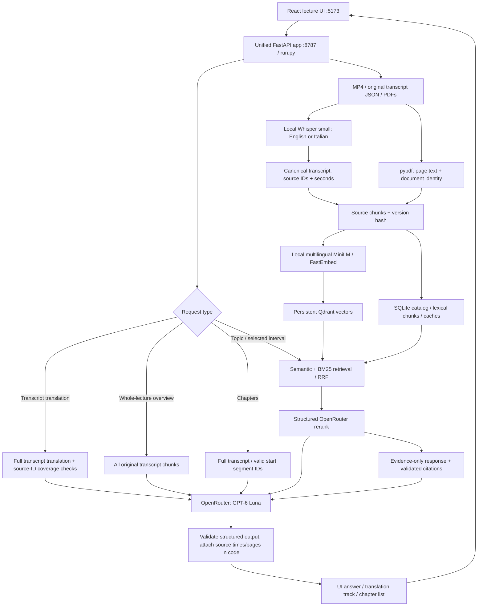

# Architecture — inputs, knowledge, tools, decisions, outputs

## Required architecture mapping

| Element | What this prototype uses |
| --- | --- |
| Input | Operator-uploaded MP4, original English/Italian transcript JSON, PDF documents, question, optional <=120-second interval, chosen output language |
| Knowledge | The active version of the selected lecture's original transcript and extracted PDF text; limited prior conversation provides context, not source evidence |
| Tools | FFmpeg/Whisper, pypdf, FastEmbed/ONNX, Qdrant, SQLite, OpenRouter, FastAPI and React |
| Decisions | Detect EN/IT; route topic questions versus whole-lecture summaries; fuse retrieval ranks; rerank and assess evidence sufficiency; reuse valid caches; enforce conservative request estimates; validate output identifiers |
| Output | Original/translated navigable transcript, grounded explanation, refusal when evidence is insufficient, time/PDF citations, whole-lecture overview, chapters and persistent chat turns |

## Code ownership and paths

- `run.py` starts the integrated app. `src/lecture_rag/unified_api.py` joins the
  browser-facing routes to the modules and reuses the teammate's persistent chat
  store and chapter helpers under `polimi-lectures/services/chatbot/lecturemind/`.
- `src/lecture_transcription/` handles original-language ASR and timestamps.
- `src/lecture_translation/` validates complete ordered translation coverage;
  adjacent source fragments can form one natural translated unit. Word timings
  are not fabricated for translated text.
- `src/lecture_rag/` owns source chunks/versions, embeddings, Qdrant, BM25/RRF,
  reranking, source-grounded generation, budgets and the optional standalone API.
- `polimi-lectures/apps/web/` owns playback, transcript/answer language controls,
  source upload, polling, chat and citation rendering. Vite proxies
  `/chatbot-api` and `/media` to the unified API.

## Custom decisions that matter

1. **One shared source of truth:** AI uploads go to `.local/web/media`; the same
   original transcript feeds display, translation and indexing. Browser-only
   previews do not silently change the server's sources.
2. **Original-language retrieval:** translations are a separate display track.
   The selected response language does not require re-embedding translated copies.
3. **Hybrid retrieval:** local multilingual vectors retrieve semantic matches;
   BM25 helps technical terms; RRF fuses ranks. Up to 20 candidates are reranked,
   then a small final evidence set supports a topical answer.
4. **Source authority:** times and PDF pages come from source metadata and are
   attached by code. The model supplies allowed source IDs. Identifier validation
   prevents unknown citations; it does not prove every natural-language claim.
5. **Coverage for overviews:** broad whole-lecture summaries use all original
   transcript chunks instead of presenting a top-k retrieval excerpt as complete.
6. **Version-safe persistence:** source edits activate a new index after vectors
   are ready. Query filters select the active version. Failed reindexing does not
   expose partial new vectors. Translation caches bind to their source hash.
7. **Bounded costs:** local embeddings avoid the account's blocked hosted
   embedding model. Calls reserve a conservative estimate in SQLite. Successful
   reported cost can replace it; uncertain failures remain reserved. Translation
   has a separate request cap. There are no automatic paid retries.
8. **Local background jobs:** Whisper and full transcript translation run off the
   HTTP request thread; duplicate active jobs are reused. This is not a durable
   distributed queue. Replacing a video archives its previous transcript.

## Persistence and external boundaries

| Location | Data |
| --- | --- |
| `.local/web/media/` | Uploaded local videos, original transcript JSON and PDFs |
| `.local/web/translations/` | Validated translated tracks keyed to original source |
| `.local/web/chats.sqlite3` | Persistent chat threads and messages |
| `.local/web/prepared/` | Prepared lecture/chapter SQLite and source fingerprints |
| `.local/rag/` | Qdrant files, source catalog, caches and spending ledger |
| `.local/rag/models/` | Downloaded local embedding weights |
| Repository-root `.env` | Local API secret/configuration; excluded from source control and delivery |

Topic answers send retrieved source text to OpenRouter. Translation, chapters
and overviews may send the complete transcript. Embedding/ASR inference is local.
The with-data delivery includes the prepared `ml-01` media/translation/chapter
state only, not personal chats or model/embedding caches. The prototype is local, lecture-scoped and lacks real authentication, account
isolation, OCR, visual slide recognition, slide translation and dubbing. A PDF
content match does not establish which slide was visible at a video timestamp.
